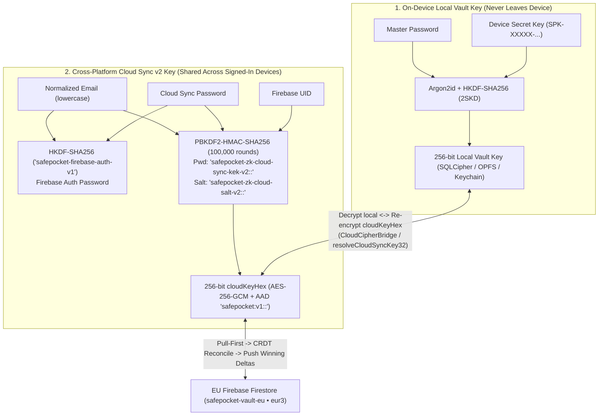

# SafePocket `v0.4.0` (`Build 15`) — Cross-Platform Architecture & Security Specification

## 1. Platform Architecture Overview

SafePocket combines a **Kotlin Multiplatform (KMP)** shared domain/crypto/sync core with 100% platform-native shells across mobile, desktop, and web:

| Target | Stack | Local Encrypted Storage | Hardware Biometrics & Security |
| :--- | :--- | :--- | :--- |
| **Android 10+ (`API 29+`), Foldables & Googlebook OS (`arm64-v8a` + `x86_64`)** | Kotlin + Jetpack Compose Material 3 Adaptive (`ListDetailPaneScaffold`, freeform desktop windowing) | SQLDelight + SQLCipher (`safepocket_vault.db`) | `BiometricPrompt` + Android Keystore, optional `FLAG_SECURE`, 30s clipboard clear |
| **macOS Native Desktop (`Apple Silicon` + `Intel`)** | SwiftUI + AppKit (`NavigationSplitView`, `.ultraThinMaterial`, native context menus) | AES-256-GCM Vault Snapshot + macOS Keychain | `LAContext` Touch ID, 30s `NSPasteboard` scrub, Ed25519 verified `.dmg` self-updater |
| **ChromeOS & Web Standalone PWA** | TypeScript + Vite + Service Worker (`safepocket-offline-v0.4.0`) | `sql.js` SQLite WASM + OPFS (`safepocket_vault_v01.sqlite3`) | WebAuthn Passkey unlock, WebCrypto `AES-256-GCM`, 30s clipboard clear |

---

## 2. Dual-Domain Zero-Knowledge Cryptographic Architecture (`v0.4.0`)

SafePocket cleanly separates **on-device local database encryption** from **cross-platform Cloud Sync encryption** so devices with independent local vaults can synchronize seamlessly without ever exposing plaintext or keys to Firebase:

### Cryptographic & Sync Invariants (`Cross-Platform Sync v2`)
1. **Deterministic Cloud Sync Key (`cloudKeyHex`)**:
   - Derived identically on Kotlin (`HkdfSha256Pure.deriveCloudSyncKey`), Swift (`MacZeroKnowledgeCrypto.deriveCloudSyncKeyHex` via `CommonCrypto`), and WebCrypto (`deriveZeroKnowledgeCloudSyncKeyHex`) using `100,000` rounds of `PBKDF2-HMAC-SHA256`.
   - Verified against pinned cross-platform test vector (`clara@safepocket.eu` / `MyStrongCloudPass!2026` / `uid_eu_test_12345` → `e5f20ce7e6b0f14c9175cd10bba9dafb54f4e2014d2d7e89b9edb97684df6001`).
2. **Canonical Wire Payload & Bound AAD**:
   - Every synced item encrypts canonical UTF-8 JSON (`schemaVersion: 1`, `id`, `category`, `title`, `subtitle`, `favorite`, `pinned`, `tags`, `cardTheme`, `fields` including `URL` enum, `attachments`, integer `createdAtEpochMs` / `updatedAtEpochMs`) under `AES-256-GCM` (`96-bit` random IV + `128-bit` tag) with bound AAD `safepocket:v1:<CATEGORY>:<ITEM_ID>`.
3. **Pull-First CRDT Reconciliation & Zero Idle Writes**:
   - Every sync cycle executes **Pull Full Delta Snapshot (`sinceHlc = null`) → Version-Vector + `:`-Delimited HLC Reconciliation → Push Only Winning Local Deltas**.
   - Idle background syncs perform `0` Firestore writes when local and remote HLCs match.
   - Untouched built-in sample catalog items (`SampleVaultCatalogIds`) are never pushed to Cloud Sync.
   - Deletions emit persistent encrypted tombstones (`{"deleted":true}`, `isTombstone = true`) so deleted items never resurrect across offline peers.
4. **Instant & Live Sync Cadence**:
   - Triggered immediately on item create/edit/delete, on app launch/unlock, on window focus/app foregrounding (`Lifecycle.State.RESUMED` / `didBecomeActiveNotification` / `visibilitychange`), on network restoration, and via a non-disruptive **5-second live background sync loop** while unlocked and not editing.

---

## 3. Google Play Protect Compliant Distribution & Update Verification (`Ed25519` + `SHA-256`)

1. **Signed Release Manifest (`manifest/version.json`)**:
   - Signed by `scripts/sign-update-manifest.mjs` with **RFC 8032 Ed25519** over the canonical v2 descriptor (`channel`, `latestVersion`, `versionCode`, `minimumSupportedVersionCode`, sorted `artifact:sha256:sizeBytes`) and verified against `PINNED_RELEASE_ED25519_PUBKEY_HEX` (`b793fdd180549d2d3f226fb13798fa85e2f85901d44c20fa85c2a6bde25420be`).
2. **Android & Googlebook OS (`PlayProtectPackageInstaller.kt`)**:
   - Declares **only** `INTERNET`, `ACCESS_NETWORK_STATE`, and `USE_BIOMETRIC` in `AndroidManifest.xml`.
   - Intentionally excludes `REQUEST_INSTALL_PACKAGES` and `PackageInstaller.Session` so Google Play Protect never classifies SafePocket as a sideloaded dropper PHA. Verified updates open the official GitHub Release HTTPS asset via `Intent.ACTION_VIEW` in the system browser.
3. **macOS (`SafePocketMacApp.swift`)**:
   - Verifies Ed25519 signature via `Curve25519.Signing.PublicKey` and `SHA256` digest of the universal `.dmg` before mounting and staging `SafePocket.app`.
4. **ChromeOS / Web PWA (`PwaUpdateController` + `sw.js`)**:
   - Verifies Ed25519 manifest signature + `/sw.js` SHA-256 digest before activating updated offline caches.
