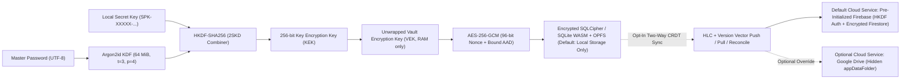

# SafePocket `v0.1` — Cross-Platform Architecture & Security Specification

## 1. Cross-Platform Architecture Evaluation: Flutter vs. Kotlin Multiplatform (KMP)

| Criterion | Flutter (Impeller + Web WASM + `macos_ui`) | **Selected: Kotlin Multiplatform (KMP) Shared Core + Platform-Native UI Shells** |
| :--- | :--- | :--- |
| **Android 17+, Foldables & Googlebook OS (ARM64 + x86_64)** | Requires platform channels for `PackageInstaller` sessions, `FoldingFeature` postures, and desktop window hints; canvas text/input layer sits above Android views. | **First-party Day-0 native (`Jetpack Compose` + `material3-adaptive`)**. Native `ListDetailPaneScaffold`, freeform `resizeableActivity="true"` without restarts, hardware `Ctrl+F/N/L`, hover, right-click menus, drag-and-drop scans, `BiometricPrompt`, and `PackageInstaller` Session API in pure Kotlin. |
| **ChromeOS Standalone PWA (100% Offline)** | Ships ~3–8 MB Skwasm/CanvasKit engine; renders to opaque `<canvas>`, dynamic font fallback downloads for Greek (`el`), heavier cold start. | **KMP `js`/`wasmJs` + Native Web M3 Expressive Shell**. Sub-100ms cold launch, crisp native DOM/UTF-8 Greek & Latin typography with 35% text expansion resilience, WebCrypto `AES-256-GCM` + `Argon2id` WASM, **SQLite WASM + OPFS** (`safepocket_vault_v01.sqlite3`), WebAuthn Passkeys, and direct `ServiceWorkerRegistration.update()` / `skipWaiting()` control. |
| **macOS Native Desktop (Apple HIG)** | Community `macos_ui` mimics macOS controls on a Metal canvas; lacks authentic AppKit window vibrancy, unified `NSToolbar`, and native `NSMenu`. | **KMP `SafePocketShared.xcframework` + 100% Native SwiftUI/AppKit**. Authentic `.ultraThinMaterial` sidebar vibrancy, `.windowToolbarStyle(.unified)`, `Cmd+F/N/L`, native context menus, `LAContext` Touch ID, and native **Sparkle** (`SPUStandardUpdaterController`) wired to `SafePocket -> Check for Updates...`. |
| **Shared Business Logic, Crypto, Sync & l10n** | High sharing in Dart, but FFI/MethodChannels required for SQLCipher, Argon2id, and native updaters. | **100% shared zero-knowledge domain**: canonical schema, Two-Secret Key Derivation (`Argon2id` + `SecretKey`), `AES-256-GCM` envelopes, CRDT (`HLC` + Version Vectors) bidirectional sync, pre-initialized Firebase Auth & Firestore + Google Drive (`appDataFolder`) adapters, offline ICAO Doc 9303 MRZ parser, 6-language ARB/JSON catalogs, and Ed25519 + SHA-256 `version.json` update verifier. |

---

## 2. Zero-Knowledge Cryptographic, SQLite WASM & Pre-Initialized Firebase Architecture

### Storage, Firebase & Security Invariants
- **Starting Baseline (`v0.1`, Build `1`):** All targets (`androidApp`, `pwaApp`, `macosApp`, `shared`) initialize at semantic version `0.1` (`versionCode = 1`), displaying `SafePocket v0.1 (Build 1)` in Settings/About and desktop sidebars.
- **Local Storage by Default + Pre-Initialized Standby Firebase Database:**
  - Out-of-the-box (`cloudSyncEnabled = false`), SafePocket stores 100% of encrypted rows inside local SQLite (`SQLCipher` on Android/macOS; `sql.js` **SQLite WASM + OPFS** on ChromeOS PWA) with zero network traffic.
  - At startup (`bootstrap()`), `FirebaseVaultService.initializeDormant()` initializes the Firebase Zero-Knowledge engine in standby mode.
  - **Zero-Knowledge User Creation & Sign-In:** Cloud Sync users can create accounts (`createCloudUser`) and sign in (`signInCloudUser`). Client credentials pass through domain-separated `HKDF-SHA256("safepocket-firebase-auth-v1")` derivation before reaching Firebase Identity Toolkit (`accounts:signUp` / `accounts:signInWithPassword`) or the embedded SQLite Firebase replica—ensuring Firebase never sees the user's Master Password or Vault Encryption Key.
  - **1-Command Live Firebase Setup:** Running `scripts/setup-firebase.sh <project-id>` deploys `firebase/firestore.rules`, `firebase/storage.rules`, and `firebase/firestore.indexes.json` and writes `.env.local` automatically.
- **Offline ICAO Doc 9303 MRZ Scanner & Card Validators:** Parses **TD3 Passports (`2×44`)** and **TD1 National IDs (`3×30`)** 100% offline with 7-3-1 composite check-digit verification, alongside offline Luhn PAN and ISO-13616 Mod-97 IBAN checks.
- **30-Second Clipboard Hygiene & Idle Auto-Lock:** Sensitive copies auto-scrub after 30 seconds; `IdleAutoLockMonitor` wipes unwrapped keys from RAM after configurable `1m / 5m / 15m` inactivity.

---

## 3. Google Play Protect Compliant Self-Update Architecture (`Ed25519` + `SHA-256`)

1. **Cryptographically Signed Manifest (`manifest/version.json`):** Signed via `scripts/sign-update-manifest.mjs` using **Ed25519** over the canonical v2 descriptor (`channel`, `latestVersion`, `versionCode`, `minimumSupportedVersionCode`, sorted `artifact:sha256:sizeBytes`). Verified via WebCrypto `crypto.subtle.verify({ name: 'Ed25519' }, ...)` pinned to `PINNED_RELEASE_ED25519_PUBKEY_HEX`.
2. **Android 17+ & Googlebook OS (`PlayProtectPackageInstaller.kt`):** Minimal permissions (`INTERNET`, `USE_BIOMETRIC`, `REQUEST_INSTALL_PACKAGES`), APK Signature Scheme **v2/v3/v4**, streaming `SHA-256` + signing-certificate pinning before committing `PackageInstaller.Session` (`MODE_FULL_INSTALL`, `USER_ACTION_NOT_REQUIRED`).
3. **ChromeOS PWA (`PwaUpdateController` + `sw.js`):** Verifies Ed25519 signature on `version.json`, verifies constant-time `SHA-256` of `/sw.js`, dispatches `SKIP_WAITING` + `REFRESH_OFFLINE_CACHE`, and reloads into the updated offline bundle.
4. **macOS (`MacSparkleUpdateController`):** Native Sparkle (`SPUStandardUpdaterController`) wired to both `SafePocket -> Check for Updates...` and Settings.
